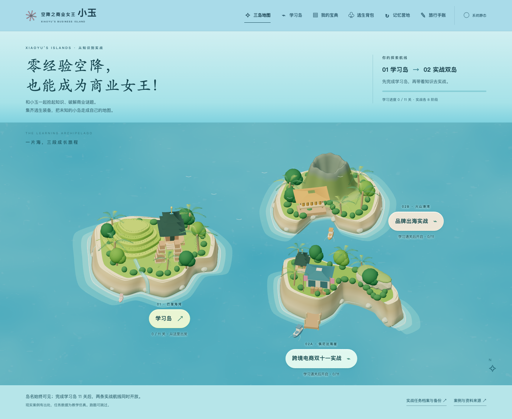

# 空降之商业女王小玉

**一款为零经验接触商业化与出海业务的人准备的网页闯关学习小游戏。**

零经验空降，也能成为商业女王！和小玉一起拾起知识、破解商业谜题，集齐逃生装备，把未知的小岛走成自己的地图。

[打开游戏](https://keicyzhu.github.io/xiaoyu-business-island/) · [玩法手册](docs/PLAY_GUIDE.md) · [知识库](docs/knowledge/README.md) · [产品 PRD](docs/PRD.md)

**v0.5.0：学习岛与实战双岛。**保留两版课程、案例和存档，以先学后练的三岛旅程串联。



## 一片海上的三岛旅程

首页在同一个 3D 海面上展示三座地形不同的岛。先完成「学习岛」的 11 关，再同时解锁「跨境电商双十一实战」和「品牌出海实战」。两条实战独立推进，可任选先后；学习岛仍可返回复习。

| 岛屿 | 角色与内容 | 规模与进入条件 |
|---|---|---|
| 学习岛 | 从指标、市场、渠道、测量到经营与治理 | 11 关、33 概念、11 案例、44 道本课题；从这里开始 |
| 跨境电商双十一实战 | TikTok Shop 用户增长产品经理：指标字典、用户分层、DNC 拉新、MAC 促活留存、召回激励、A/B 与 ROI、协同上线、效果评估 | 8 阶段、48 题；学习岛完成后开放 |
| 品牌出海实战 | 中国蟹黄酱品牌 GTM 负责人：市场、STP、SKU 与食品条件、定价、渠道支付、整合营销、首发履约、复购现金扩张 | 8 阶段、48 题；学习岛完成后开放 |

学习海湾、佩尼达海崖与火山港湾采用原创代码模型，借鉴巴厘地理、奥比岛的连续岸线与地标组织、奥拉星的区域主题差异，统一圆润岸线、植被与浅水视觉。没有复制其游戏资产，也不声称高保真复刻。

两座实战岛合计 **16 阶段、96 道多题型题、48 项阶段概念、16 份开放方案**。现实案例明确实体、市场、时间与来源；业务表格和决策效果为教学仿真，不是企业内部数据。

DNC/MAC 使用明确训练定义，**不是 TikTok Shop 内部官方口径**：DNC 为 Asia/Jakarta 自然日内首次有效支付的去重买家；MAC 为该时区自然月内有效支付的去重买家。身份、退款和截止规则由任务字典说明。平台线保留用户提供的增长岗位 JD，不改回旧商业化岗位题。

## 从学习走到实战

1. 在三岛地图进入「学习岛」，从「空降海滩」依次完成概念、案例自查和选择试炼。
2. 学习案例先写至少 20 字，再自查至少 3 项；每道本课题曾答对一次后完成该关。
3. 完成全部 11 关，两座实战岛同时开放。学习岛的轻跑酷可跳过，不影响解锁。
4. 任选实战岛，阅读公开案例和独立仿真表格，选择业务方案，完成每阶段 6 道题。
5. 写至少 40 字方案、自查至少 3 项；客观题全对且已选择方案后提交，解锁该线下一阶段。
6. 在实战任务档案查看选择、资源和文字交付，导出备份。两条实战没有跑酷。

实战采用固定业务材料与可累计决策账本。预算、准备度与信任会承接到下一阶段，材料表不会自动生成市场预测；开放方案仅自查，不是 AI 评分。详见[实战任务说明](docs/product/twin-campaigns.md)。

## 原有进度如何延续

学习岛与两条实战沿用各自旧存档，不清空记录。旧实战档案仍可查看和导出；如果学习岛尚未完成，实战暂不能继续填写或提交，补完 11 关后恢复。重置学习进度也会重新锁定实战入口，但不删除已有实战记录。

学习岛原 11 个案例保留淘宝天猫、TikTok 品牌、DANA/Lazada、Changi Pay/Alipay+ 等公开背景与独立仿真任务，不拼接成同一家平台的内部系统。宝典、装备、错题与可选动作段继续保留，见[玩法手册](docs/PLAY_GUIDE.md)与[学习岛奖励](docs/product/game-map.md)。

## 公开知识库

本轮将现有资料纳入统一来源目录，形成两本原创整合手册，共 38 节（含方法、映射、综合练习与来源治理）：

- [商业主线手册](docs/knowledge/business-handbook.md)：14 节，覆盖市场、GTM、本地化、SEO、创意、广告机制、指标、归因、单位经济、留存、库存、现金和治理。
- [进阶方法手册](docs/knowledge/advanced-handbook.md)：24 节，覆盖实验、因果、拍卖／预算、RAG、Text2SQL、Agent、评测与可复现工程，含 21 道小练习。
- [学习路线](docs/knowledge/learning-path.md)：说明先学什么、如何复习、何时需要进阶方法。
- [来源覆盖报告](docs/knowledge/coverage-report.md)：27 条原目录项＋550 条导入项的校验、重复处理、阅读范围和缺口。

新增 GTM 资料去重为18份唯一材料，TikTok 面试参考去重为282页一份PDF，已用于两条实战线的策略、指标、题型与交付设计。面试材料的编号错配、重复和未证实数字已校订，不当作官方真题背书。

577 是此前资料盘点中包含重复、网页缓存和无关文件的文件级条目数量，不能解释为 577 篇教材。公开内容是原创组织和模拟练习，未转载私人原图、付费原文或内部案例。扩展教材已提供，但进阶支线与更多题库尚未全部实现。

## 本地运行

需要 Node.js 20 或更新版本。

```sh
git clone https://github.com/KeicyZhu/xiaoyu-business-island.git
cd xiaoyu-business-island
npm run dev
```

打开 `http://127.0.0.1:4173/`。

Three.js 0.180.0 已固定在 `src/vendor`；运行、测试和构建不需要联网安装依赖或配置密钥。

```sh
npm test
npm run build
```

`dist/` 是可托管的静态产物。本地服务与构建仅提供允许的 HTML、JavaScript、CSS、SVG 和许可文件；不能直接托管包含私人资料的整个开发目录。

## 项目文档

| 文档 | 内容 |
|---|---|
| [产品 PRD](docs/PRD.md) | 产品理念、用户、范围、知识库、流程、奖励、数据、验收与后续 |
| [玩法手册](docs/PLAY_GUIDE.md) | 从第一关到复习、存档、装备与常见问题 |
| [知识库目录](docs/knowledge/README.md) | 商业主线与进阶方法的统一入口 |
| [地图与奖励](docs/product/game-map.md) | 与实际课程同步的地区、概念、宝典和装备 |
| [架构与维护](docs/product/architecture.md) | 模块、状态、资源释放和开发命令 |
| [部署说明](docs/deployment/README.md) | GitHub Pages 源码／网页分支和更新流程 |
| [变更记录](CHANGELOG.md) | 可恢复的版本与实际修改 |
| [素材和许可](RIGHTS.md) | 原创代码、第三方依赖与角色边界 |

## 质量与范围

v0.5 已通过 42 项自动测试、构建和真实浏览器检查：学习 0／10／11 关门槛，实际完成末关并进入实战，16 阶段／96 题完整通关与刷新回放，1440／768／390／320px 三岛标签，WebGL 丢失恢复及无 WebGL 学习，损坏存档保护和存储失败草稿保留。具体检查命令见架构文档。

当前没有跨设备账号、在线学习统计、AI 简答评分、自动间隔复习或独立迁移认证。正确率只统计本课答题和补练，不包括上一关回顾与记忆营地复习。平台当前政策、市场资格、税费和物流规则需要按实际地区与时间另行核验。

项目由 KeicyZhu 维护。角色是基于 YuY 参考绘制的非官方学习原型；本项目不代表官方联名或授权。第三方权利不因源码公开而转让，详见 [RIGHTS.md](RIGHTS.md)。
