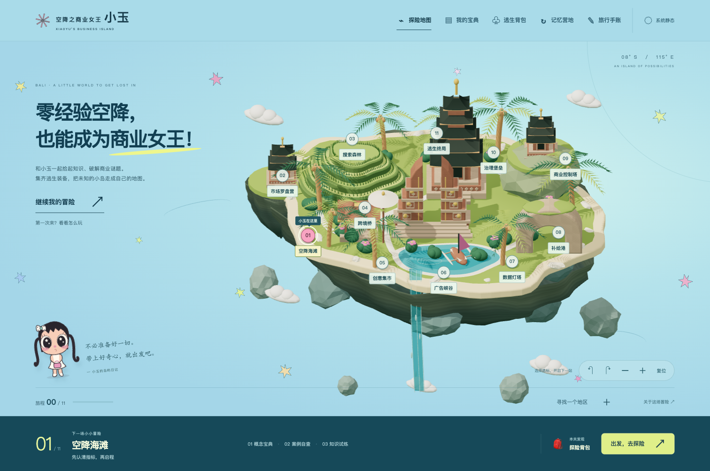

# 空降之商业女王小玉

**一款为零经验接触商业化与出海业务的人准备的网页闯关学习小游戏。**

零经验空降，也能成为商业女王！和小玉一起拾起知识、破解商业谜题，集齐逃生装备，把未知的小岛走成自己的地图。

[打开游戏](https://keicyzhu.github.io/xiaoyu-business-island/) · [玩法手册](docs/PLAY_GUIDE.md) · [知识库](docs/knowledge/README.md) · [产品 PRD](docs/PRD.md)



## 游戏是什么

小玉空降到一座巴厘风格的悬浮商业岛。沿着 11 个名字常显的地区，先理解概念，再判断商业案例，最后通过选择试炼，获得宝典、逃生线索和装备。

地图包含分体石门、多层庙宇、梯田、海崖、椰树、泻湖与瀑布。v0.3 在浮岛风格上加入自然岩层、薄弯屋檐、羽状椰叶、程序材质与浅水细节，向更自然的微缩景观过渡。它是知识地图，不是现实旅游路线。

- 11 个学习地区、33 张概念卡、11 个原创案例、44 道本课选择题。
- 后续地区混入上一关回顾题，正常首通共呈现 54 次选择题。
- 案例自查、错题解释、补练、宝典、装备与旅行手账。
- 轻跑酷可跳过；动作失误不扣学习成果。
- 本地存档和导入／导出，无注册、模型 API 或答案上传。
- 支持键盘、手机、减少动画和无 WebGL 降级。

## 第一轮怎么玩

1. 进入「空降海滩」，阅读三张概念卡并领取指标宝典。
2. 写至少 20 字的案例判断，再对照要点完成至少 3 项自查。
3. 完成试炼，答错可看解释并补练；每道本课题至少答对一次后获得装备。
4. 体验或跳过跑酷，解锁下一地区。
5. 随时从宝典、背包、记忆营地或旅行手账继续学习。

完整操作、存档、动作控制与常见问题见[玩法手册](docs/PLAY_GUIDE.md)。案例采用本地自评，不是 AI 评分；首通与原题答对不代表职业认证或长期掌握。

## 地图上的知识

| 学习阶段 | 地区 |
|---|---|
| 起步：目标、用户与需求 | 空降海滩 → 市场罗盘营 → 搜索森林 |
| 获客与承诺 | 跨境桥 → 创意集市 → 广告峡谷 |
| 测量与经营 | 数据灯塔 → 补给港 |
| 平台、治理与综合判断 | 商业控制塔 → 治理堡垒 → 逃生终局 |

查看完整[地图、宝典与奖励表](docs/product/game-map.md)。

## 公开知识库

本轮将现有资料纳入统一来源目录，形成两本原创整合手册，共 38 节（含方法、映射、综合练习与来源治理）：

- [商业主线手册](docs/knowledge/business-handbook.md)：14 节，覆盖市场、GTM、本地化、SEO、创意、广告机制、指标、归因、单位经济、留存、库存、现金和治理。
- [进阶方法手册](docs/knowledge/advanced-handbook.md)：24 节，覆盖实验、因果、拍卖／预算、RAG、Text2SQL、Agent、评测与可复现工程，含 21 道小练习。
- [学习路线](docs/knowledge/learning-path.md)：说明先学什么、如何复习、何时需要进阶方法。
- [来源覆盖报告](docs/knowledge/coverage-report.md)：27 条原目录项＋550 条导入项的校验、重复处理、阅读范围和缺口。

577 是包含重复、网页缓存和无关文件的文件级条目数量，不能解释为 577 篇教材。公开内容是原创组织和模拟练习，未转载私人原图、付费原文或内部案例。扩展教材已提供，但进阶支线与更多题库尚未全部实现。

## 本地运行

需要 Node.js 20 或更新版本。

```sh
git clone https://github.com/KeicyZhu/xiaoyu-business-island.git
cd xiaoyu-business-island
npm run dev
```

打开 `http://127.0.0.1:4173/`。

Three.js 0.180.0 已固定在 `src/vendor`；运行、测试和构建不需要联网安装依赖或配置密钥。

```sh
npm test
npm run build
```

`dist/` 是可托管的静态产物。本地服务与构建仅提供允许的 HTML、JavaScript、CSS、SVG 和许可文件；不能直接托管包含私人资料的整个开发目录。

## 项目文档

| 文档 | 内容 |
|---|---|
| [产品 PRD](docs/PRD.md) | 产品理念、用户、范围、知识库、流程、奖励、数据、验收与后续 |
| [玩法手册](docs/PLAY_GUIDE.md) | 从第一关到复习、存档、装备与常见问题 |
| [知识库目录](docs/knowledge/README.md) | 商业主线与进阶方法的统一入口 |
| [地图与奖励](docs/product/game-map.md) | 与实际课程同步的地区、概念、宝典和装备 |
| [架构与维护](docs/product/architecture.md) | 模块、状态、资源释放和开发命令 |
| [部署说明](docs/deployment/README.md) | GitHub Pages 源码／网页分支和更新流程 |
| [变更记录](CHANGELOG.md) | 可恢复的版本与实际修改 |
| [素材和许可](RIGHTS.md) | 原创代码、第三方依赖与角色边界 |

## 质量与范围

v0.3 包含自动化状态／课程／跑酷／构建测试，以及真实浏览器中的 11 关通关、存档恢复、手机布局、名称常显、上下文丢失／恢复和存储失败验证。具体检查命令在架构文档中。

当前没有跨设备账号、在线学习统计、AI 简答评分、自动间隔复习或独立迁移认证。正确率只统计本课答题和补练，不包括上一关回顾与记忆营地复习。平台当前政策、市场资格、税费和物流规则需要按实际地区与时间另行核验。

项目由 KeicyZhu 维护。角色是基于 YuY 参考绘制的非官方学习原型；本项目不代表官方联名或授权。第三方权利不因源码公开而转让，详见 [RIGHTS.md](RIGHTS.md)。
