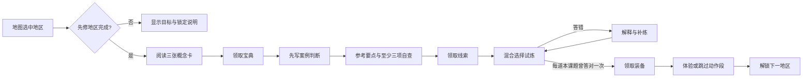

# 产品需求文档：空降之商业女王小玉

版本：v0.5.0。日期：2026-10-20。状态：三岛连续旅程已实现并通过本版验收。维护者：KeicyZhu。

当前入口为学习岛 → 两座实战岛；第 13 节保留 v0.4 历史职责来源，第 14 节说明本版门控及兼容性。历史已发布状态不代替本版验收。

## 1. 产品定义

《空降之商业女王小玉》是一款面向零经验商业化与出海学习者的网页闯关小游戏。以同一海面上的三岛世界连接学习与实战：先完成学习岛 11 关，再同时解锁「跨境电商双十一实战」和「品牌出海实战」。将商业知识组织成「理解概念 → 判断案例 → 试炼反馈 → 获得奖励 → 继续探索」的过程。

产品不要求已有广告账户、真实店铺或专业术语基础。打开浏览器即可开始，进度留在设备，案例不上传外部服务。它适合建立知识框架、练习解释业务判断，也可展示知识结构与产品设计；不提供职业资格认证或经营收益保证。

首页文案固定为：

> 零经验空降， 
> 也能成为商业女王！ 
> 和小玉一起拾起知识、破解商业谜题。 
> 集齐逃生装备，把未知的小岛走成自己的地图。

## 2. 用户与问题

| 用户 | 当前困难 | 产品提供的帮助 | 本版边界 |
|---|---|---|---|
| 第一次接触商业化／广告的学习者 | 缩写多、口径混、资料散 | 先修顺序、三概念小节、例子和错误解释 | 不是完整职业培训 |
| 准备了解出海业务的转岗者／学生 | 渠道、市场、履约与利润难以串联 | 11 地区主线和综合案例 | 不提供现行国家法规答案 |
| 已经读过资料但缺少练习的人 | 看过不等于能解释，缺反馈 | 案例自查、混合试炼、错题营地 | 没有自动简答评分与迁移认证 |
| 作品或课程评审者 | 难以判断设计和内容从何而来 | PRD、地图、公开教材、来源覆盖、测试 | 不把模拟结果当真实业绩 |

关键任务：进入时知道从哪里开始；每关理解一个小主题；遇到错误能知道为什么；退出后知道自己学到了哪里；需要进一步学习时能找到系统教材。

## 3. 产品理念

1. **先理解，再操作。** 初学者先分清目标和指标，再学习渠道、预算与实验，不以记住工具按钮代替商业判断。
2. **让知识之间有路。** 地图顺序表达先修关系：指标 → 市场 → 获客与承接 → 广告 → 测量 → 经营 → 平台 → 治理 → 综合判断。
3. **反馈帮助继续探索。** 错题给出解释，允许补练；动作失败不扣学习奖励，没有倒计时知识竞赛或羞辱式失败。
4. **奖励对应可见进展。** 阅读、案例和试炼分别留下宝典、线索、装备，避免单一分数掩盖学习过程。
5. **诚实表达能力边界。** 阅读过、完成自查、原题答对和独立迁移是不同状态，本版只记录实际发生的行为。
6. **资料能追溯，原文不公开搬运。** 公开教材重新组织概念、原创案例与方法；来源盘点、重复和缺口有独立记录。

## 4. 范围与优先级

| 优先级 | 当前实现 | 验收口径 |
|---|---|---|
| P0 | 原生静态网页、GitHub Pages 托管 | 仓库子路径下页面与全部资源可加载 |
| P0 | 共用海面的三岛首页、各岛不同地形 | 三个岛名与开放状态常显；学习岛内 11 个地标名称常显 |
| P0 | 学习毕业后同时开放两条实战 | 学习 0／10 关均锁定，11 关同时开放；两条实战互不设前置 |
| P0 | 两条实战各 8 阶段／48 题 | 保留用户增长 JD 与品牌 GTM，固定材料和决策账本 |
| P0 | 11 章、33 概念、11 案例、44 本课题 | 与课程数组、状态测试和地图表一致 |
| P0 | 三阶段学习与依次解锁 | 未完成前一关不能通过 DOM 操作／导入绕过规则 |
| P0 | 本地存档、导入导出、错误恢复 | 事件重放验证；失败提示持续可见 |
| P0 | 手机、键盘、减少动画与 WebGL 降级 | 320／390px 可操作，弹窗暂停背景，降级可继续学习 |
| P0 | 公开知识库、README、玩法手册、PRD | 链接完整，区分现有实现与扩展内容 |
| P1 | 其他因果／AI 支线、独立迁移题 | 两条业务实战之外的扩展，尚未全部实现 |
| P1 | 间隔复习与学习诊断 | 已有错题记录，未实现自动复习日程 |
| 非本版 | AI 简答评分、真实投放接入、社交排行、跨设备账号 | 不默认开启或收集外部数据 |

## 5. 知识架构与完整目录

公开知识库采用「来源家族 → 知识主题 → 学习目标 → 主线／扩展阅读 → 原创练习」五层结构。全库入口和详细目录见[知识库 README](knowledge/README.md)，来源审计见[覆盖报告](knowledge/coverage-report.md)。

| 来源家族 | 现有资料规模 | 整合位置 |
|---|---|---|
| SEO／国际化／整合营销 | 24 个文件，其中有分章、合订、模板与元数据 | 商业手册 02—06、学习路线与方法模板 |
| 广告运营面试资料 | 2 份字节相同的 223 页 PDF，按 1 份内容处理 | 指标、投放、创意与客户／经营判断 |
| 基础知识笔记 | 1 份 1,460 行 Markdown，10 个附件引用缺失 | 商业主线定义、口径纠错与术语 |
| AMS 投放入门 | 45 张截图的已有 OCR | 广告角色、目标、排序、计费与预测边界 |
| 广告／因果／AI 方法资料 | 44 PDF 共 514 页；Office、HTML 和导航图；另含非教材缓存与无关项目 | 进阶手册、机制／实验／AI／工程方法 |
| 电商资料 | 5 PDF 共 43 页 | 商品、内容电商、治理、经营与商家工具 |

27 条原目录项与 550 条导入项共 577 个文件级条目已核对哈希。这个数字包含重复、缓存和无关文件，不是教材篇数。完整整理表示来源与主题都纳入分类和去重，不表示所有图表、外链和现行政策均完成核验。

商业手册包括 14 节：商业目标、市场与 GTM、本地化、搜索需求、技术／多语言 SEO、渠道创意、广告机制、指标漏斗、归因增量、单位经济、留存 LTV、现金库存履约、平台治理、综合经营。

进阶手册覆盖归因与诊断、因果问题、A/B、统计不确定性、CUPED、实验分流、PSM/IPW、准实验、uplift、干扰与 switchback、DR/DML/BART、广告机制与预算、多目标模型、RAG、Text2SQL、Agent、AI 评测与可复现工程。它们当前以教材和练习提供，不把目录标题伪装为已开发关卡。

### 内容准入规则

- 同一概念按定义、口径和适用条件去重，不按简称直接合并。
- 区分 CTR／pCTR、计费／优化、ROAS／利润 ROI、归因／增量、收入 LTV／贡献 LTV。
- 案例采用原创模拟数字，明确计算分母、窗口、币种与成本项。
- 现行政策、费率、市场开放与产品功能，使用前需按官方来源及日期复核。
- 错配网页、缺图公式和外链占位不得推测补齐；资料内部个案不成为通用行业规律。

## 6. 游戏地图

三岛首页共用一个 WebGL 海面。学习岛采用巴厘海湾与梯田主题，跨境电商双十一实战采用佩尼达海崖与码头主题，品牌出海实战采用火山环湖与市集港湾主题。模型是原创程序生成，参考奥比岛的连续岸线与地标组织、奥拉星的地区主题差异和巴厘地理；统一圆润海岸、柔光、植被和浅水视觉，不复制素材或声称高保真还原。

进入学习岛后，保留以下 11 个地区及原学习地图；它是知识路线，不是现实景点导览。

| 顺序 | 地区 | 核心学习目标 |
|---|---|---|
| 01 | 空降海滩 | 区分 CTR、CVR、ROAS 与其分母 |
| 02 | 市场罗盘营 | 明确客群、主张和最小市场验证 |
| 03 | 搜索森林 | 理解意图、发现索引与页面承接 |
| 04 | 跨境桥 | 将语言、市场与履约承诺一起核对 |
| 05 | 创意集市 | 用可验证假设设计卖点和测试 |
| 06 | 广告峡谷 | 分清计费、优化与漏斗问题 |
| 07 | 数据灯塔 | 区分归因、增量与对照实验 |
| 08 | 补给港 | 计算广告后贡献，考虑库存和现金 |
| 09 | 商业控制塔 | 区分预测／观察，并平衡多方目标 |
| 10 | 治理堡垒 | 理解误杀漏放、复核申诉与护栏 |
| 11 | 逃生终局 | 提出有证据、有约束的综合方案 |

完整宝典和奖励见[地图表](product/game-map.md)，机器可读定义见[game-map.json](product/game-map.json)。查看所有名称和预览任务不会越过解锁条件。

## 7. 核心流程与状态

三岛地图先开放学习入口。以下循环完成 11 次后，同时开放两条实战；每条实战内部依次解锁 8 阶段，但两条线可以自由选择先后。

状态由事件重放计算。主要事件为 LEARN、DRAFT、CASE、ANSWER、COMPLETE、REVIEW、SETTINGS。草稿允许编辑，同一关只保留最新草稿；完成奖励具有幂等性。导入不会相信外部快照中的「已通关」字段，而是验证事件。

## 8. 奖励机制

| 奖励 | 触发 | 数量 | 用途 |
|---|---|---|---|
| 宝典 | 完成三概念阅读 | 每地区 1 本，共 11 本 | 随时复读定义、例子与易错点 |
| 线索 | 案例达到输入条件并完成自查 | 每地区 1 条，共 11 条 | 形成逃岛路线，保留判断记录 |
| 装备 | 完成本课试炼 | 每地区 1 件，共 11 件 | 探索反馈，部分改变动作体验 |
| 新地区 | 前一地区完成 | 依次开放 | 控制先修关系和认知负担 |
| 自由航线 | 学习岛 11 关完成 | 学习终局 1 次 | 同时开放两条实战，仍可返回复习 |

绳索、小船、翅膀分别改变跃高、水面段和下落速度。动作失败不扣除奖励；无随机付费抽取、广告解锁或付费跳关。

## 9. 界面与交互要求

- 产品名、首页文案与用户指定版本一致。
- 共用海面上的三岛为首页主体，不使用两张独立场景卡片作为入口；学习阅读面板清晰安静。
- 模型从玩具积木向自然微缩景观过渡：自然分层岩壁、植物结构、薄檐庙宇、适度材质与水面反光。当前不以照片级写实为目标。
- 首页三个岛名及学习进度常显；进入学习岛后，11 个地标名字常显。手机保留可操作入口，不能用隐藏名字解决拥挤。
- 鼠标／触屏／键盘均可选择岛屿入口；学习岛内部地图可旋转、缩放、复位。正文有明确焦点和关闭方式。
- 装饰运动低频、弱于任务反馈；系统减少动画优先，阅读弹窗暂停背景。
- 渲染失败保留学习入口，显示降级状态；存储失败持续提示导出。

## 10. 技术与数据

原生 HTML、CSS、JavaScript，Three.js 0.180.0 本地模块；Node.js 只用于开发服务、测试和构建。静态产物使用相对路径，可部署仓库子路径，无服务器数据库或模型 API。

| 项目 | 当前规则 |
|---|---|
| 保存位置 | localStorage：学习岛 `xiaoyu-island-save-v1`；两条实战 `xiaoyu-twin-campaign-v1` |
| 存档版本 | 两套事件规则沿用 1.0.0；学习界面显示课程／规则版本，导出保存规则版本；产品 v0.5 不改写历史键 |
| 大小限制 | 学习存档 UTF-8 5 MiB／最多 10,000 条事件；实战存档 2 MiB／最多 500 条导入事件 |
| 答案处理 | 本地保存，导出含案例文本与作答记录 |
| 随机性 | 固定种子与可回放事件，便于复现 |
| 资源发布 | 网页白名单产物；公开仓库使用审阅后的代码与原创文档 |
| 隐私 | 无登录、无学习答案上传、无远程分析 SDK |

## 11. 验收与效果评估

v0.5 验收覆盖：自动测试及构建通过；学习 0／10／11 关门控正确；11 关完成后两条实战同时解锁；各 8 阶段可独立推进；旧档案可读可导出，补完学习后恢复；三岛名称及入口在窄屏可见；减少动画、上下文恢复与无 WebGL 降级可用；导入损坏文件保留原进度；存储失败不覆盖原始数据；GitHub 页面发布后在线检查。已通过42项自动测试、构建、末关毕业实际操作、16阶段96题全流程、四档三岛布局、WebGL丢失恢复和无WebGL学习、配额失败及损坏实战存档保护。线上结果另见版本发布记录。

产品效果为待验证假设，不虚构成绩。未来可在征得同意的研究中观察首次理解率、首关完成率、案例解释质量、数日后同构新题表现、独立迁移表现与放弃原因。当前没有埋点系统，手账正确率只统计本课 ANSWER（含补练），不统计 REVIEW 回顾／复习，不能直接替代这些指标。

## 12. 后续路线与风险

| 后续事项 | 为什么需要 | 本版处理 |
|---|---|---|
| 其他进阶题库与支线 | 全库主题多于学习岛和两条业务实战 | 因果／AI 等内容先提供系统教材，明确未实现关卡 |
| 独立迁移与间隔复习 | 原题重试不能证明长期掌握 | 文档提供练习建议，不宣称认证 |
| 跨境履约／关务课程 | 现有资料不完整且具有市场时效性 | 记录缺口，真实政策另行核验 |
| AI 简答反馈 | 可提升反馈，但有成本、隐私与准确性风险 | 当前不接入 |
| 素材与知识来源 | 第三方权利不可由项目自行授予 | 原图／付费原文不发布，说明非官方角色原型 |
| 移动性能 | 常显标签与模型细节增加密度 | 纹理小型化、重复几何实例化、低动态与降级 |

工程架构见[架构说明](product/architecture.md)，操作见[玩法手册](PLAY_GUIDE.md)，知识阅读见[知识库](knowledge/README.md)。

## 13. v0.4 双子岛增量需求（历史来源，入口由第 14 节替代）

2026-10-19 用户要求以现实互联网电商平台／海外移动支付为案例背景，并建立两条主线。随后补充 TikTok Shop 用户增长 JD，为平台线设定最新职责。

- **用户增长岛**：双十一业务背景下的指标字典、DNC/MAC问题拆解、生命周期／活跃／价值分层、拉新／促活／留存／召回、补贴激励、A/B与增长ROI、跨团队上线和复盘。
- **品牌出海岛**：中国蟹黄酱品牌从市场研究、STP、SKU与食品条件、定价、渠道支付、整合营销到首发履约和复购扩张。
- 两线各8阶段，合计96题（单选、多选、数值、排序），48项阶段概念与16份开放交付。每阶段业务选择影响显式仿真预算／准备／信任和下一阶段交接。
- DNC/MAC按用户授权采用明确训练定义，不冒充TikTok内部字典。具体时区、用户身份、退款与截止点必须写入材料。
- 所有现实案例标实体／市场／时间／来源，数据表单独标仿真。不同平台／支付服务案例是比较材料，不拼接成同一内部系统。
- 新主线无跑酷；录制两支独立demo展示完整业务流程。原11关作为基础营地，旧存档继续可用，案例背景更新，44道基础题保留。
- 用户允许使用GTM图片，按精确白名单发布2张已检查图片，保留水印和用途边界；整包原文不公开。

本节记录 v0.4 当时的独立双岛入口与基础营地定位。岗位职责、题目和案例继续保留，当前先学后练入口以第 14 节为准；其他因果／AI 支线仍未全部实现。详细任务与指标见[实战任务说明](product/twin-campaigns.md)。

## 14. v0.5 三岛连续旅程与兼容性（当前规则）

- 首页同时显示学习岛、跨境电商双十一实战、品牌出海实战；学习岛 11 关全部完成后，两条实战同时开放，各 8 阶段／48 题，互不要求对方先通关。
- 平台线仍是 TikTok Shop 用户增长 PM，保留生命周期／活跃／价值分层、DNC/MAC、拉新激活留存召回、激励、A/B、ROI 和产品／数据／运营协作。DNC/MAC 是用户授权的教学定义，Asia/Jakarta 自然日／月、统一身份、有效支付及退款规则均在材料字典可查。
- 学习岛仍保留 33 概念、44 道本课题、11 个真实公开背景案例和可选跑酷；动作不参与实战门控。学习毕业引导玩家回到三岛地图选择实战。
- `journey.js` 从已经过事件重放验证的学习状态派生完成数；实时实战草稿与提交经过前置检查。此规则控制本地学习顺序，不声明服务器鉴权或防作弊能力。
- 原存档键和事件版本不变。历史实战重放不追补新的学习前置事件；旧档案与导出继续可用，但学习未完成时暂停继续实战。补完学习后恢复，重置学习也只重新锁定入口，不清空实战记录。
- 实战按固定材料、选择和累计预算／准备度／信任展开，不模拟真实市场预测。每阶段须客观题全对、策略已选、方案至少 40 字、自查至少 3 项且预算足够；文字质量仍由自己或导师审阅。
- 图形与门控已接入本地代码；浏览器回归、构建审核与发布完成情况应另记真实结果，本 PRD 不提前声明成功。
