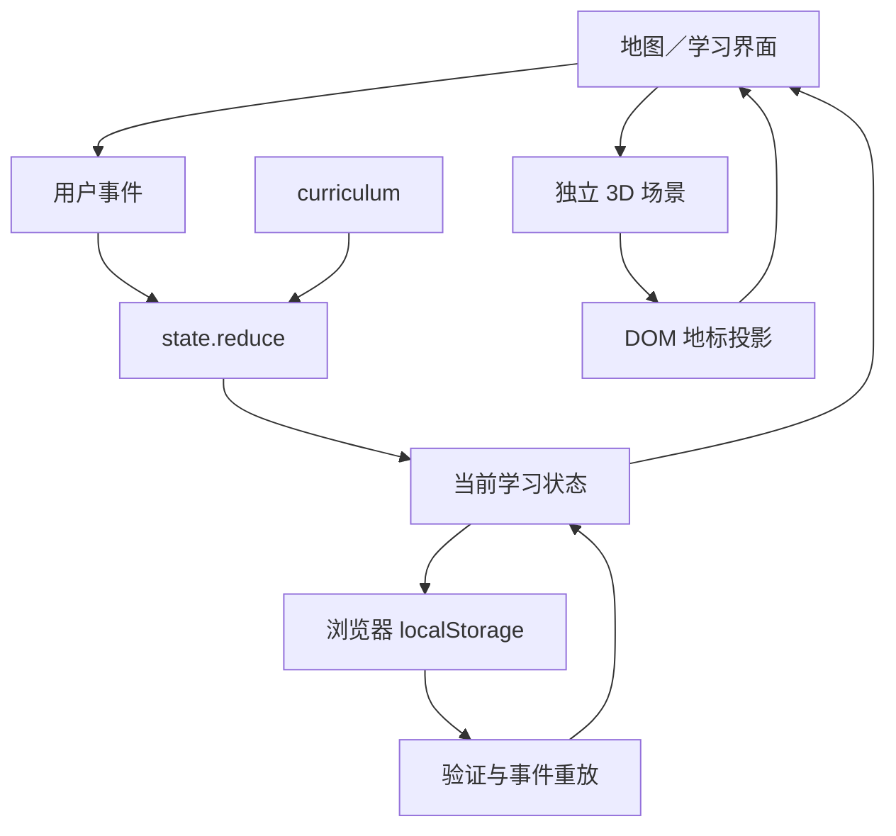

# 网页架构与维护

## 模块职责

| 文件 | 职责 |
|---|---|
| index.html | 静态入口、标题和资源引用 |
| src/app.js | 页面、课程弹窗、导航、输入事件和本地保存 |
| src/curriculum.js | 11 地区、33 概念、案例、44 本课题与来源 |
| src/state.js | 纯状态归约、锁关、奖励幂等、存档验证与事件回放 |
| src/island-scene.js | Three.js 地形、模型、材质、光照、投影、相机和 GPU 生命周期 |
| src/runner.js | 可跳过的轻跑酷、固定种子与装备动作 |
| src/styles.css / world.css | 学习界面基础与场景视觉系统 |
| src/vendor | 固定 Three.js 0.180.0 模块与上游许可头 |
| tools/server.mjs | 只提供允许的公开文件 |
| tools/build.mjs | 生成可托管的 dist 白名单产物 |
| tests | 状态、课程、跑酷、构建和访问边界测试 |



## 状态和异常恢复

课程数据决定顺序与奖励；地图显示不直接授予进度。导入会验证大小、版本、事件、题目和顺序，通过重放生成状态。草稿合并以限制存档膨胀，已提交案例和答题保留。

存储失败时，持续提示与导出入口仍在；成功领取奖励的文案不能掩盖未保存状态。导出是用户在设备上保存自己的答案，不发送给服务器。

WebGL 失败保留平面地图；上下文丢失时恢复二维位置并禁用相机控件。恢复前清理旧 GPU 绑定，避免资源释放指向旧上下文。离开地图时取消动画、监听器和 ResizeObserver，并释放材质、纹理与几何。

## 开发和检查

```sh
npm run dev
npm test
npm run build
```

Node.js 20 及以上。运行时依赖已固定为本地模块，以上命令不需要 API 密钥。浏览器 QA 工具是开发辅助，不属于产品运行时依赖。

- tools/check-visual.mjs：地图投影、上下文丢失／恢复、降级、导航、手机布局。
- tools/check-save-failure.mjs：模拟满额存储，检查持续告警和导出。
- tools/check-web-build.mjs：静态构建在仓库子路径加载、动画暂停和场景资源统计。

QA 使用独立浏览器会话，不能清空使用者的日常浏览器存档。

## 发布结构

源码分支提供游戏代码与审阅后的原创文档，网页分支只提供 dist。知识原件、账号排障记录、私人图片、浏览器存档和临时输出不进入公开发布。

网页所有本地引用使用相对路径，支持 https://账号.github.io/仓库/。不要将本地完整资料目录作为网络服务根目录。部署前运行测试和构建；发布后在实际 URL 验证入口、模块、样式、地图与学习弹窗。

## 扩展约束

新增课程应同时补充概念先修、案例、自查要点、题目解释、奖励、来源与状态回归。新增计费服务或上传学习答案需要重新设计权限和说明，不能以补充文案为由静默开启。

图库继续以原创程序化资产为主；第三方素材使用范围在 RIGHTS.md 中说明，Three.js 许可在 THIRD_PARTY_NOTICES.txt。

## v0.4 双岛模块

campaigns-data.js 聚合两条任务和公开来源；campaigns-state.js 管理独立事件存档、题型判定、顺序与资源累计；campaigns-ui.js / campaigns.css 管理双岛、四步骤工作台、报告与备份。campaign-double11.js 依据最新用户增长JD，不再使用早期纯广告产品主线。

real-case-lessons.js 更新原基础营地的11案例；旧存档键与规则保持。assets/gtm只有两张PNG加入精确白名单，不开放任意图片路径。

check-twin.mjs验证16阶段96题真实UI全流程，check-twin-layout.mjs覆盖手机四步骤与图片白名单。新主线没有跑酷。
